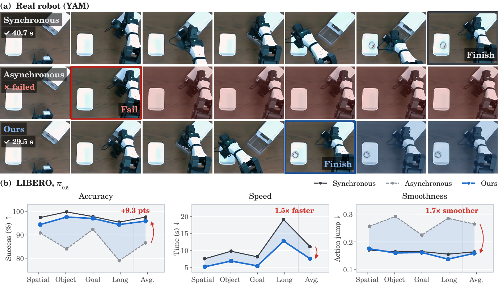

<div align="center">

<h1>DelayOPSD: On-Policy Self-Distillation from a Synchronous Teacher<br>for Real-time Asynchronous Policies</h1>

Hyeonjae Kim<sup>1*</sup>&ensp;
Jeongsol Kim<sup>1*</sup>&ensp;
Sunwoo Park<sup>1</sup>&ensp;
Chanyu Moon<sup>1</sup>&ensp;
Yoojin Oh<sup>1</sup>&ensp;
Youngjun Jun<sup>1</sup>&ensp;
Kyumin Choi<sup>2</sup>&ensp;
Jong Chul Ye<sup>1†</sup>

<sup>1</sup>KAIST&emsp;<sup>2</sup>Sungkyunkwan University<br>
<sup>*</sup>Equal contribution&emsp;<sup>†</sup>Corresponding author

<a href="https://arxiv.org/abs/2611.30534"></a>
<a href="LICENSE"></a>

</div>

<p align="center"></p>

<p align="center"><b>DelayOPSD keeps the speed of asynchronous execution with success and smoothness close to synchronous execution.</b><br>
Synchronous execution is accurate and smooth but pauses between action chunks, whereas asynchronous execution removes the pauses but fails more often and jumps at chunk switches.</p>

## Abstract

Flow-based vision-language-action (VLA) policies incur substantial inference latency due to their large vision-language backbones and iterative denoising.
Asynchronous execution reduces this latency by generating the next action chunk while executing the current one, but the new chunk is conditioned on a stale observation, degrading performance as the delay increases.
We investigate this mismatch by comparing actions predicted from observations at planning and execution times.
We find that these predictions differ little on expert demonstrations but diverge substantially on the policy's own delayed rollouts, particularly in failed episodes.
Motivated by this observation, we propose **DelayOPSD**, which trains an asynchronous policy to imitate its synchronous counterpart on the policy's own rollouts.
Specifically, a synchronous teacher, obtained from the same policy using the observation at execution time, supervises a delayed student that observes only the earlier frame and the actions still being executed.
The student learns to match the teacher throughout its own denoising process.
Under a 10-step delay, training SmolVLA on demonstrations achieves only 70.2% success, comparable to naive asynchronous execution (70.4%), whereas training on its own rollouts improves success to 78.7%.
Across LIBERO and Kinetix, DelayOPSD achieves the highest average success among the compared methods, without introducing additional modules at deployment.
On a real robot, it further improves success from 46% to 62%.

## Contributions

- **Asynchronous execution as on-policy self-distillation from the synchronous policy.** We train the policy on its own delayed rollouts, and its teacher is the same policy run synchronously on the execution-time observation. SmolVLA then reaches 78.7% at K=10, against 70.2% when trained on demonstrations.
- **Distillation on the student's own states in physical and denoising time.** On the student's rollouts, using the student's own samples in denoising time instead of re-noised teacher samples adds 3.4 points of success on average over delays.
- **Highest average success with no module added at deployment.** DelayOPSD has the highest average success of all compared methods on LIBERO (SmolVLA, π0.5) and Kinetix, without an inference-time module or simulator lookahead at deployment, and raises real-robot success from 46% to 62%. It needs no rollouts interleaved with training, which makes training on a real robot practical.

## Release

- [x] Training and evaluation code: LIBERO (π0.5, SmolVLA), Kinetix, real robot
- [ ] Checkpoints
- [x] [arXiv paper](https://arxiv.org/abs/2611.30534)

## Installation

```bash
git clone https://github.com/present091/DelayOPSD.git && cd DelayOPSD
conda create -n delayopsd python=3.12 && conda activate delayopsd
pip install -e .              # pinned LeRobot with π0.5, SmolVLA, PEFT, LIBERO; MuJoCo 3.2.3
pip install -e ".[server]"    # only for the real-robot inference server
```

The code builds on [LeRobot](https://github.com/huggingface/lerobot) at `2774d9b` plus one commit that adds training-time action conditioning to SmolVLA ([`present091/lerobot@delayopsd`](https://github.com/present091/lerobot/tree/delayopsd)).

## Checkpoints and data

Our checkpoints are coming soon (one folder per model, placed under `checkpoints/`).

| | source | path used by the configs |
|:--|:--|:--|
| π0.5 LIBERO start policy | [`lerobot/pi05_libero_finetuned`](https://huggingface.co/lerobot/pi05_libero_finetuned) @ `8e17415` | `checkpoints/pi05_libero_finetuned` |
| π0.5 LIBERO demonstrations (v3.0, 1,693 episodes) | [`lerobot/libero`](https://huggingface.co/datasets/lerobot/libero) @ `a1aaacb` | `data/libero` |
| π0.5 LIBERO teacher (8.8 GB) | ours, coming soon | `checkpoints/pi05_libero_teacher` |
| π0.5 LIBERO student, EMA (1.7 GB, LoRA + action expert) | ours, coming soon | `checkpoints/pi05_libero_student` |
| SmolVLA LIBERO start policy (also the teacher) | [`lerobot/smolvla_libero`](https://huggingface.co/lerobot/smolvla_libero) @ `a24f1f3` | (hub id) |
| SmolVLA LIBERO demonstrations | [`HuggingFaceVLA/libero`](https://huggingface.co/datasets/HuggingFaceVLA/libero) @ `8695891` | `data/libero_smolvla` |
| SmolVLA LIBERO student, EMA (217 MB, LoRA + action expert) | ours, coming soon | `checkpoints/smolvla_libero_student` |
| YAM start policy, teacher (8.8 GB each), student (1.7 GB) | ours, coming soon | `checkpoints/pi05_yam_8task`, `checkpoints/yam_teacher`, `checkpoints/yam_student` |
| YAM teleoperation dataset, robot rollouts | not released | |

## LIBERO

Replan every `R = 10` steps; the new chunk takes over `k` steps after its observation while the running
chunk keeps executing (`R:k = 10:k`). Four suites, 50 episodes per task (seed `1000 + episode`, recorded initial
states), 500 episodes per suite.

`eval.sh <method> <k>` evaluates `ours` (the DelayOPSD student) or `async` (the base policy with a naive switch;
`async 0` is synchronous execution).
Results are written to `outputs/eval/` (π0.5) or `outputs/eval_smolvla/` (SmolVLA) under `<method>_10_<k>/<suite>/`:
`summary.json` and a per-episode `episodes.csv` with scene and state hashes, so two methods can be compared episode by
episode. Per-chunk latency: `python -m delayopsd.eval.latency --help`.

### π0.5

```bash
# start policy and demonstrations
huggingface-cli download lerobot/pi05_libero_finetuned --revision 8e174154ef5f6c60a8da12ae99c303d8963138c1 \
  --local-dir checkpoints/pi05_libero_finetuned
huggingface-cli download lerobot/libero --repo-type dataset \
  --revision a1aaacb7f6cd6ee5fb43120f673cebb0cfea7dd4 --local-dir data/libero

# train
bash scripts/pi05_libero/collect_buffers.sh   # 11 rollout buffers, 10:0 .. 10:10 (~18 GPU-h)
bash scripts/pi05_libero/train.sh teacher     # stage 1 (~3 h, one RTX 4090)
bash scripts/pi05_libero/train.sh student     # stage 2 (~17 h, one RTX 4090)

# evaluate
bash scripts/pi05_libero/eval.sh ours 10      # DelayOPSD at 10:10
bash scripts/pi05_libero/eval.sh async 10     # naive asynchronous execution at 10:10
bash scripts/pi05_libero/eval.sh async 0      # synchronous execution
```

### SmolVLA

256 px renders, the frozen start policy as the teacher (no stage 1).

```bash
# demonstrations (the start policy is loaded from the hub)
huggingface-cli download HuggingFaceVLA/libero --repo-type dataset \
  --revision 86958911c0f959db2bbbdb107eb3e17c5f9c798e --local-dir data/libero_smolvla

# train
bash scripts/smolvla_libero/collect_buffers.sh   # 11 rollout buffers, 10:0 .. 10:10
bash scripts/smolvla_libero/train.sh             # student, 10K updates

# evaluate
bash scripts/smolvla_libero/eval.sh ours 10      # or: async 10, async 0
```

### Configurations

`configs/<setting>/{teacher,student}.json` are the configurations of the paper's runs: LeRobot's
`TrainPipelineConfig` plus the `opsd` group documented in `delayopsd/config.py`. Any field can be overridden on the
command line, e.g. `--steps=1000 --output_dir=outputs/try`.

<details>
<summary>Student settings shared by both LIBERO models</summary>

- 11 buffers (`k = 0..10`), drawn uniformly over the delay
- clean prefix of `min(k, 10)` actions
- frozen teacher, trust weights `exp(-r/30)` over the teacher's chunk index
- student EMA 0.999, and the EMA weights are evaluated
- failed episodes kept until 30 steps after the arm stalls, and dropped when their scene also fails synchronously
- loss on the buffer pairs only (`lambda_fm = lambda_mask = 0`); the demonstration dataset is loaded for its metadata

</details>

## Kinetix

`kinetix/` holds the JAX implementation on the [Real-Time Chunking](https://github.com/Physical-Intelligence/real-time-chunking-kinetix)
Kinetix benchmark (12 levels, delays 0..4), as files added to that repository; `kinetix/setup.sh` clones it at the
commit we used. See [`kinetix/README.md`](kinetix/README.md).

## Real robot (YAM)

`real_robot/` holds the pipeline for the right arm of a YAM robot (`15:15`, relative joint actions):

- converting teleoperation recordings to a LeRobot dataset
- building the rollout buffer from asynchronous robot sessions, with the prefix and the teacher's state re-expressed in
  each frame (`delayopsd/relative.py`)
- the configs `configs/yam/{teacher,student}.json`
- the inference server the robot station queries (`real_robot/server`; modes: synchronous, naive asynchronous, ours)
- tests of the relative-action path

See [`real_robot/README.md`](real_robot/README.md).

## Repository structure

```
delayopsd/
├── flow.py             prefix KV cache, masked velocity, Euler sampling with a clean prefix (π0.5);
│                       routes SmolVLA to flow_smolvla.py with the same interface
├── flow_smolvla.py     the same for SmolVLA (causal action tokens)
├── objective.py        masked flow matching and the DelayOPSD loss (trust weights)
├── data/buffer.py      pairs from rollout buffers: index, failure rules, delay mixing
├── train.py, config.py trainer for both stages and both models
├── collect.py          rollout-buffer collection
├── eval/               asynchronous-execution evaluation, latency
└── checkpoints.py      LoRA checkpoint -> evaluable copy (base + adapter)
configs/, scripts/      pi05_libero, smolvla_libero, yam
real_robot/             YAM data conversion, robot buffers, inference server, tests
kinetix/                Kinetix (JAX, on the Real-Time Chunking code)
```

## Citation

```bibtex
@article{kim2026delayopsd,
  title   = {DelayOPSD: On-Policy Self-Distillation from a Synchronous Teacher for Real-time Asynchronous Policies},
  author  = {Kim, Hyeonjae and Kim, Jeongsol and Park, Sunwoo and Moon, Chanyu and Oh, Yoojin and Jun, Youngjun and Choi, Kyumin and Ye, Jong Chul},
  journal = {arXiv preprint arXiv:2611.30534},
  year    = {2026}
}
```

## Acknowledgements

Built on [LeRobot](https://github.com/huggingface/lerobot) and the π0.5 checkpoints of
[openpi](https://github.com/Physical-Intelligence/openpi) ported to it. The asynchronous protocol and the Kinetix
benchmark are those of [Real-Time Chunking](https://github.com/Physical-Intelligence/real-time-chunking-kinetix).

## License

[Apache 2.0](LICENSE).
